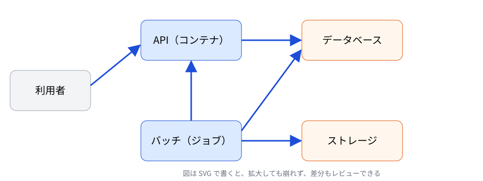
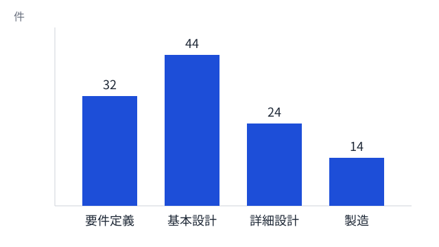

<!-- _class: title -->

# L01 表紙

サブタイトル（目的・対象を 1 行で）
2026-10-02 ／ 所属・氏名

---

<!-- _class: agenda -->

# L02 目次

1. 背景と課題
2. 進め方
3. 効果の見込み
4. 次のアクション

---

<!-- _class: section -->

# L03 中扉

1. 背景と課題

---

# L04 箇条書き（基本）

- 1 枚に 1 つのメッセージ。タイトルに結論を書く
- 箇条書きは 3〜5 個、入れ子は 2 段まで
- 強調は **1 か所** だけにする

---

# L05 2 列の比較

### 現状

- 手作業で転記している
- 確認は目視のみ

### 導入後

- 自動で転記する
- 差分を機械で検出する

---

# L06 3 つのカード

<h3>速く</h3>
作成の時間を半分にする

<h3>正しく</h3>
機械チェックで漏れを防ぐ

<h3>そろえて</h3>
様式と書き方を統一する

---

# L07 図と説明（左に図）

- API とバッチは同じデータベースを使う
- ファイルはストレージ経由で受け渡す
- 図は SVG で作る（L16）

---

<!-- _class: message -->

# L08 キーメッセージ

伝えたいことを 1 文で。聞き手が持ち帰る言葉にする

---

<!-- _class: big-number -->

# L09 大きな数字

48<small>%</small>

作成時間の削減（試行 3 件の平均）

---

# L10 指標の並び

120

対象の設計書

35%

指摘の削減

2.1h

1 件あたりの短縮

0

重大な漏れ

数字には出典と期間を添える（例: 2026 年 4〜9 月、試行チーム）

---

# L11 表

| 項目 | 現状 | 目標 | 期限 |
|---|---|---|---|
| 作成時間 | 8 時間 | 4 時間 | 12 月 |
| 指摘件数 | 30 件 | 20 件 | 12 月 |
| 機械チェック | なし | 全件 | 11 月 |

表は 5 行 × 5 列まで。多いときは要点だけ載せ、全体は別紙にする

---

# L12 タイムライン

<b>10 月</b>試行の準備

<b>11 月</b>2 チームで試行

<b>12 月</b>効果の測定

<b>1 月</b>全体へ展開

---

# L13 手順（ステップ）

<b>1. 集める</b>指摘表と PR コメントを取り込む

<b>2. 分ける</b>欠陥・ノイズ・確認に分類する

<b>3. 見る</b>真因と観点の偏りを見る

<b>4. 直す</b>チェックリストに反映する

---

# L14 ビフォー・アフター

### Before

1. 設計書を開いて目で比べる
2. 差分を手で書き出す
3. 漏れに後で気づく

### After

1. 新旧のファイルを指定する
2. 差分の一覧が出る
3. 一覧を見てレビューする

---

# L15 メリット・デメリット

### メリット

- 漏れが減る
- 時間が読める

### デメリット・対策

- 初回の設定が要る → テンプレートを用意
- 慣れが要る → 手順書と勉強会

---

# L16 グラフ（SVG）

グラフは SVG で作り、数値の出典を下に書く（架空のデータ）

---

# L17 2×2 のマトリクス

<b>効果 大・手間 小</b> すぐ着手する

<b>効果 大・手間 大</b> 計画して進める

<b>効果 小・手間 小</b> 空き時間に

<b>効果 小・手間 大</b> やらない

---

# L18 引用・根拠

> 指摘の 3 割が表記・体裁で、欠陥の指摘に使える時間を圧迫している

出典: 指摘の分析（quality-analytics）2026 年 4〜9 月

- 表記は機械チェックに任せる
- レビューは欠陥の発見に集中する

---

# L19 Q&A

<h3>Q. 既存の様式でも使えるか</h3>
A. 設定ファイルで項目の位置を指定すれば使える

<h3>Q. 費用はかかるか</h3>
A. 基本は無料。LLM API を使う場合のみ従量課金

---

# L20 まとめと次のアクション

### まとめ

- 課題は手作業の比較と転記
- ツールで差分と分類を自動化する
- 効果は試行で測ってから展開する

### 次のアクション

- 10/15 試行チームの決定
- 10/31 設定ファイルの準備

